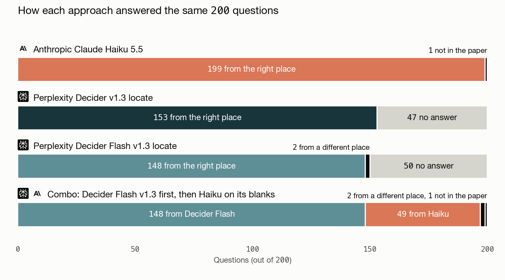
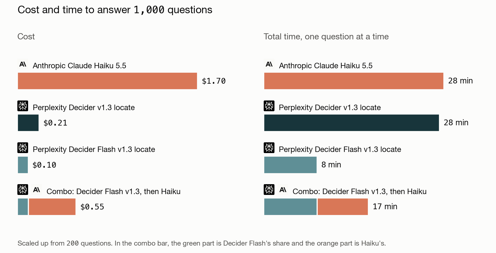
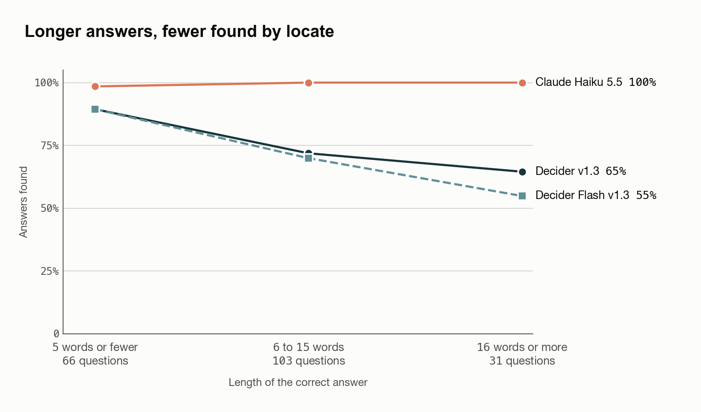

# Answer retrieval test

A small test of answer retrieval: given a document and a question, return the exact passage that answers it.

It compares two ways of doing that:

- **Perplexity Decider v1.3 and Decider Flash v1.3 `locate`**, which return the start and end position of the answer in the text.
- **Claude Haiku 5.5**, a large language model (LLM) told to copy the answering passage word for word.

There is also a **combo**: ask Decider Flash v1.3 first, and send a question to Haiku 5.5 only when `locate` returns nothing.

Every answer is checked with plain Python: is the quote in the document, character for character, and does it come from the place that holds the reference answer? No LLM judges another LLM.

## Results

200 questions about 25 arXiv papers from October and November 2026. These numbers are from the run on 16 November 2026, which is the one the write-up reports.

| | Right place | Wrong passage | Not in the paper | No answer | Cost per 1,000 questions | Median time per question |
|---|---|---|---|---|---|---|
| Claude Haiku 5.5 | 199 | 0 | 1 | 0 | $1.70 | 1.64 s |
| Decider v1.3 `locate` | 153 | 0 | 0 | 47 | $0.21 | 1.33 s |
| Decider Flash v1.3 `locate` | 148 | 2 | 0 | 50 | $0.10 | 0.50 s |
| Combo: Decider Flash v1.3, then Haiku 5.5 on its blanks | 197 | 2 | 1 | 0 | $0.55 | 0.56 s |







The full table, including 90th percentile times and some rough variations, is in `results/handoff/summary.txt`.

## There are two runs in this repo

Everything was run twice, a day apart. Both are kept so nothing is hidden.

- **Second run, 16 November 2026** (`results/handoff/`). Haiku 5.5, Decider v1.3, Decider Flash v1.3 and the combo, all on the same day. This is the run in the table and charts above.
- **First run, 15 November 2026** (`raw/`, `results/scores.csv`, `results/table.md`, `results/charts/outcomes.png`). The original pass, before the combo was added. The totals are close but not identical: Haiku 5.5 199 right in both, Decider v1.3 155 then 153, Decider Flash v1.3 149 then 148. `results/handoff/summary.txt` lists both runs side by side.

Other things in `raw/`:

- `raw/smoke/` is a 30-question rehearsal. Not results.
- `raw/followup/` is an exploratory look at rewording the `locate` request. Not results.
- `raw/memory.jsonl` is a check of what Haiku 5.5 could answer from the paper's title alone, with no text. It said it did not know 188 times out of 200.

## How the test was set up

- **Papers:** 25 arXiv papers first posted between 1 October and 10 November 2026, after Haiku 5.5's stated training cutoff. Chosen by a fixed random shuffle (seed 14) and fixed rules. `data/paper_candidates.jsonl` records every paper considered and why it passed or failed. `PAPERS.md` lists the 25 with links.
- **Questions:** 200, eight per paper, written by OpenAI `gpt-6.1-sol`. Each has a reference answer that appears exactly once in the paper. They are in `data/questions.jsonl`.
- **Frozen first:** papers, questions and scoring rules were fixed before either model was asked anything.
- **Scoring:** `src/score.py`. An answer is correct if it is an exact copy from the passage that holds the reference answer.
- **Plan for the combo:** `results/handoff/PLAN.md`, written before the second run.
- **A note on history:** this repo was reset to a single commit when it was published, so the commit log does not show the order above. The dates inside the files do.

## Run it yourself

You need [uv](https://docs.astral.sh/uv/) and your own API keys for Anthropic and Perplexity. Running everything costs well under one US dollar.

```
uv sync
cp .env.example .env              # then paste in your own API keys
uv run src/fetch_papers.py        # downloads the 25 papers from arXiv and verifies them
uv run src/score.py               # runs the scoring self-tests
uv run src/handoff.py run         # the combo: Decider Flash v1.3, then Haiku 5.5 on blanks
uv run src/handoff.py baseline    # Haiku 5.5 alone and Decider v1.3 alone
uv run src/handoff.py report      # scores everything, writes results/handoff/
uv run src/make_combo_charts.py   # rebuilds the charts
```

The chart scripts add company logos if you put `anthropic.png` and `perplexity.png` in `assets/logos/`. The logos are not included here because they are not ours to redistribute.

The first run used `src/run_arms.py full`, `src/score_run.py full` and `src/make_report.py`.

## The papers

`data/papers.jsonl` lists the 25 papers with links. Their text is not stored here, because it is not ours to republish. `src/fetch_papers.py` downloads each paper from arXiv, cleans it to plain text, and checks it against a recorded fingerprint, so you can confirm you have exactly the text that was tested. If arXiv regenerates a paper's web page, the fingerprint may no longer match.

## Limits

- 200 questions is a small test. One miss in 200 is too few to give a precise error rate.
- The papers are nearly all computer science, with almost no maths. Other kinds of document may behave differently.
- The questions and reference answers were written by a model. A sample of 20 was read by hand.
- Most papers were longer than the 8,000 tokens `locate` was trained on.
- This was built and run with Claude Code, which is made by the same company as Haiku. The scoring is plain code so you can check it.

`AGENTS.md` is the working brief used while building this. It has the full design notes and the API details checked against live documentation.

Thank you to the papers' authors, and to arXiv for use of its open access interoperability.

## Licence

The code and the data files written for this project are under the MIT licence (see `LICENSE`). The papers themselves belong to their authors and are not included.
